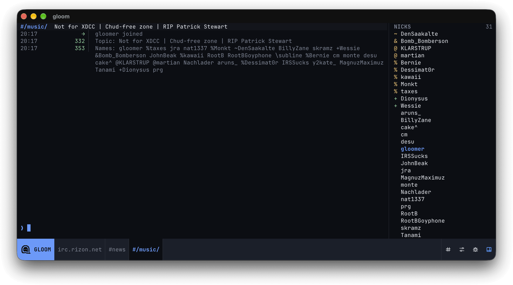

# gloom [](https://github.com/gloomafk/gloom/actions/workflows/ci.yml) [](https://go.dev) [](https://github.com/gloomafk/gloom/blob/main/LICENSE)

<picture>
    <source media="(prefers-color-scheme: dark)"
            srcset="./assets/gloom-lockup-bone-transparent.svg">
    <source media="(prefers-color-scheme: light)"
            srcset="./assets/gloom-lockup-ink-transparent.svg">
    
</picture>

A modern TUI IRC client for professional lurkers. [Haunt IRC from your terminal.](https://gloom.im/)



## Features

- Native terminal graphics: image support in [Ghostty](https://ghostty.org/) and [Kitty](https://sw.kovidgoyal.net/kitty/graphics-protocol/).
- Adaptive layouts: resizable panes that adapt to your terminal needs.
- Lightweight: a focused, single-server client with bounded scrollback and network queues.
- Privacy: no logs by default and certificate-verified TLS connections.
- Themes: switch between light and dark themes.

Gloom is in active development, expect lots of changes over the coming months.

## Build

Requires [Go](https://go.dev/dl/) 1.27 or later.

```sh
go install github.com/gloomafk/gloom/cmd/gloom@latest
```

or

```sh
git clone https://github.com/gloomafk/gloom.git
cd gloom
go build -o gloom ./cmd/gloom
./gloom -server irc.gloom.im -port 6697 -tls -nick yournick
```

## Usage

```sh
gloom -server HOST [-port PORT] [-tls] [-nick NICK]
```

## License

Licensed under the [MIT License](https://opensource.org/licenses/MIT). See [LICENSE](./LICENSE) for details.

Copyright (c) 2026-present Gloom
